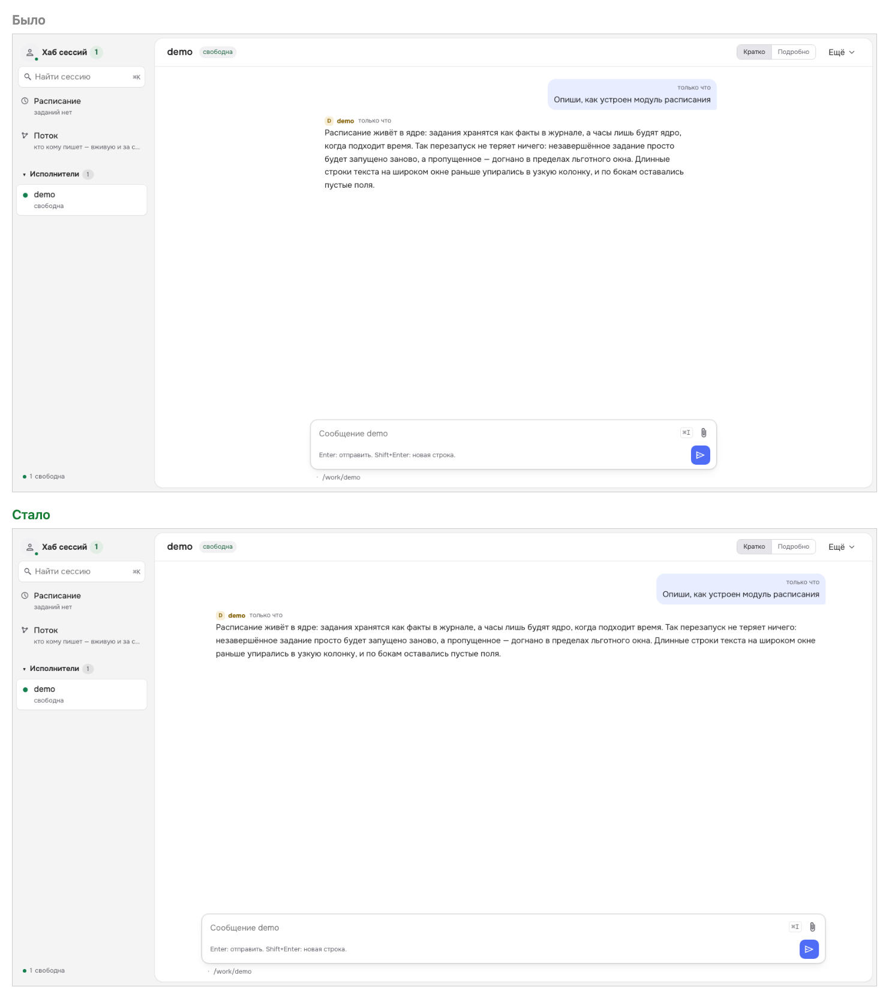

# wide-feed — a wide feed for Agents Hub

> Original author: [@Scremliss](https://github.com/Scremliss) · upstream: [Scremliss/hub-plugin-wide-feed](https://github.com/Scremliss/hub-plugin-wide-feed). This is the copy the Hub catalog installs; the author's updates are taken into it from upstream.

A hub page plugin: the message feed and the input field take a column of up to 1500 px instead of the theme's own
(800 px in Classic, 1104 px in Clean), and a line of text up to 125 characters instead of 68. On a big window there are
no more empty margins at the sides; on a narrow one the column still takes the full width, with symmetric margins from
12 to 70 px.

## Install

In Agents Hub: "Settings" → "Plugins" → "Find" → `wide-feed`.
Or tell the hub: "install the plugin wide-feed" (`hub marketplace install wide-feed`).
Turn it off in the same place, in "Plugins".

## What is inside

Only `main.js`: it adds one `<style>` to the page — the width of `.feed-inner` and `.dock-inner` and the `--measure`
variable. It reads nothing, sends nothing and does not call the hub.

## Your own sizes

Open `main.js`: `1500px` is the maximum column width, `125ch` the line length, `70px` the side margin on a wide window.

License — MIT.
